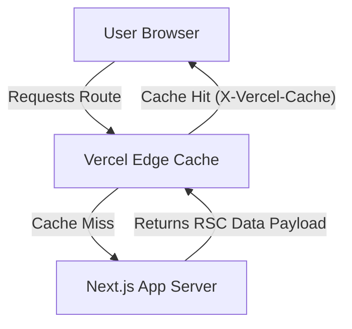

# Cynbit Technologies - Backend Technical Audit

## Backend Technical Audit Report
* **Architecture:** Cynbit utilizes Next.js with the App Router, heavily relying on React Server Components (evidenced by `_rsc` query parameters). 
* **Infrastructure:** The application is hosted on Vercel, utilizing Vercel's Edge Network for content delivery and caching. 
* **Data Handling:** API payloads are well-sanitized. Inspection of the RSC wire format reveals no over-fetching of sensitive backend data or internal directory paths; only necessary UI states and JSON-LD schema metadata are transmitted.

## Security & Performance Findings
* **Security - Strict CSP (Positive):** The backend serves a strict `Content-Security-Policy` header, successfully blocking unsafe inline scripts such as `eval()`, mitigating XSS risks.
* **Security - Information Disclosure (Minor):** The server exposes `X-Powered-By` and explicit Vercel infrastructure headers (e.g., `X-Vercel-Cache`, `X-Nextjs-Stale-Time`). 
* **Performance - Caching:** The backend employs a stale-while-revalidate caching strategy (`X-Nextjs-Stale-Time: 300`) and successfully hits the Edge cache (`X-Vercel-Cache: HIT`), ensuring optimal TTFB (Time to First Byte).
* **Performance - Layout Shift:** The server delivers lazy-loaded image tags without explicit dimensional attributes, which can cause Cumulative Layout Shift (CLS) upon rendering.

## Recommended Improvements
**1. Header Sanitization:** Configure `next.config.js` to set `poweredByHeader: false` and strip unnecessary infrastructure-identifying headers in production to reduce the reconnaissance surface.

```javascript
// next.config.js
module.exports = {
  poweredByHeader: false,
  async headers() {
    return [
      {
        source: '/(.*)',
        headers: [
          {
            key: 'X-Content-Type-Options',
            value: 'nosniff',
          }
        ],
      },
    ];
  },
};
```

**2. Image Optimization:** Update the backend templating or Next.js `<Image/>` component configurations to ensure `width` and `height` attributes are injected into all lazy-loaded DOM elements.

```javascript
// Example Next.js Image implementation
import Image from 'next/image'

export default function OptimizedHeroImage() {
  return (
    <Image alt="Cynbit Hero" height="{630}" loading="lazy" src="/assets/hero-banner.png" width="{1200}"/>
  )
}
```

## System Architecture



## CLI Endpoint Testing
Testing HTTP methods via terminal confirms standard API routing behaviors:
`curl -I -X OPTIONS https://cynbit.in`
